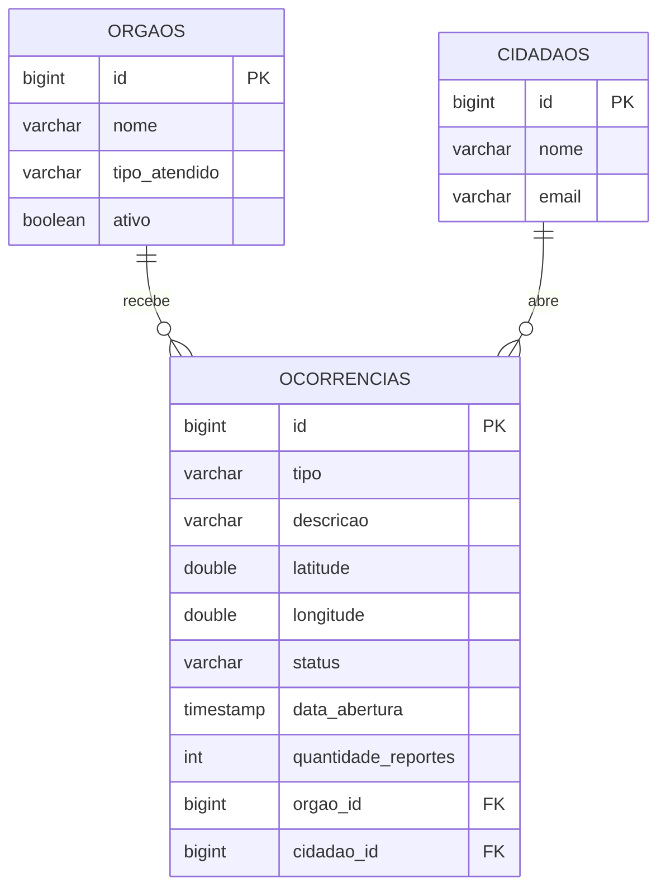

# Modelo de domínio

O CidadeViva tem **3 entidades** e **2 relacionamentos**: `Ocorrencia` pertence a um `Orgao` e foi aberta por um `Cidadao`.

## Entidades

Uma tabela por entidade. A coluna **Regra** é o que vira `NOT NULL`, `UNIQUE` ou validação no DTO.

### Orgao

Secretaria ou autoridade responsável por um tipo de problema urbano. É quem recebe as ocorrências e atualiza o status.

| Atributo | Tipo Java | Coluna | Obrigatório | Regra |
|---|---|---|---|---|
| `id` | `Long` | `id` | sim | Gerado pelo banco |
| `nome` | `String` | `nome` | sim | Até 150 caracteres |
| `tipoAtendido` | `TipoOcorrencia` | `tipo_atendido` | sim | Enum gravado como texto. É por ele que o R1 escolhe o órgão |
| `ativo` | `boolean` | `ativo` | sim | Nasce `true`; o cliente não controla. Órgão inativo não recebe ocorrências (R1) |

### Cidadao

Pessoa que reporta problemas.

| Atributo | Tipo Java | Coluna | Obrigatório | Regra |
|---|---|---|---|---|
| `id` | `Long` | `id` | sim | Gerado pelo banco |
| `nome` | `String` | `nome` | sim | Até 150 caracteres |
| `email` | `String` | `email` | sim | Até 150 caracteres. Único: dois cidadãos não repetem o e-mail |

### Ocorrencia

Um problema urbano em um local, com o andamento do atendimento. Pode ter sido reportado por mais de uma pessoa (R2).

| Atributo | Tipo Java | Coluna | Obrigatório | Regra |
|---|---|---|---|---|
| `id` | `Long` | `id` | sim | Gerado pelo banco. É o protocolo que o cidadão recebe |
| `tipo` | `TipoOcorrencia` | `tipo` | sim | Enum gravado como texto: `BURACO`, `ILUMINACAO_PUBLICA`, `COLETA_LIXO`, `VAZAMENTO_AGUA`, `SINALIZACAO` |
| `descricao` | `String` | `descricao` | sim | Até 500 caracteres |
| `latitude` | `Double` | `latitude` | sim | Entre -90 e 90 |
| `longitude` | `Double` | `longitude` | sim | Entre -180 e 180 |
| `status` | `StatusOcorrencia` | `status` | sim | Enum gravado como texto: `ABERTA`, `EM_ANALISE`, `EM_ATENDIMENTO`, `RESOLVIDA`. Nasce `ABERTA`; só o órgão muda (R3) |
| `dataAbertura` | `LocalDateTime` | `data_abertura` | sim | Preenchida pela API na criação |
| `quantidadeReportes` | `int` | `quantidade_reportes` | sim | Nasce 1; o R2 soma 1 a cada reporte agrupado. O cliente não envia |
| `orgao` | `Orgao` | `orgao_id` | sim | Definido pelo R1, nunca pelo cliente |
| `cidadao` | `Cidadao` | `cidadao_id` | sim | Quem abriu a ocorrência (o primeiro reporte) |

## Relacionamentos

| De | Para | Tipo | No banco | No código |
|---|---|---|---|---|
| Ocorrencia | Orgao | muitos para um | `ocorrencias.orgao_id` referencia `orgaos(id)` | `@ManyToOne` em `Ocorrencia` |
| Ocorrencia | Cidadao | muitos para um | `ocorrencias.cidadao_id` referencia `cidadaos(id)` | `@ManyToOne` em `Ocorrencia` |

## Diagrama ER

Como ler: `||--o{` é "um para muitos". Um órgão recebe zero ou várias ocorrências, e cada ocorrência é de exatamente um órgão. O mesmo vale para o cidadão.

## Como as regras usam o modelo

| Regra | O que consulta ou grava |
|---|---|
| R1 | Busca em `orgaos` o primeiro com `tipo_atendido` igual ao `tipo` do pedido e `ativo = true`. Sem resultado, devolve `400` |
| R2 | Busca em `ocorrencias` uma com o mesmo `tipo`, `status` diferente de `RESOLVIDA` e `latitude`/`longitude` dentro de ±0,0005° (cerca de 50 m) do ponto informado. Se achar, soma 1 em `quantidade_reportes`; se não, cria uma nova |
| R3 | Compara o `orgaoId` enviado com `ocorrencias.orgao_id`. Se forem diferentes, devolve `400` e não altera o `status` |

## Migrations

Todas existem em `src/main/resources/db/migration`, uma tabela por arquivo. A ordem importa: a tabela referenciada nasce antes da que referencia.

| Versão | Arquivo | O que cria |
|---|---|---|
| V1 | `V1__criar_orgaos.sql` | Tabela `orgaos` |
| V2 | `V2__criar_cidadaos.sql` | Tabela `cidadaos`, com `email` único |
| V3 | `V3__criar_ocorrencias.sql` | Tabela `ocorrencias`, com as duas chaves estrangeiras |
